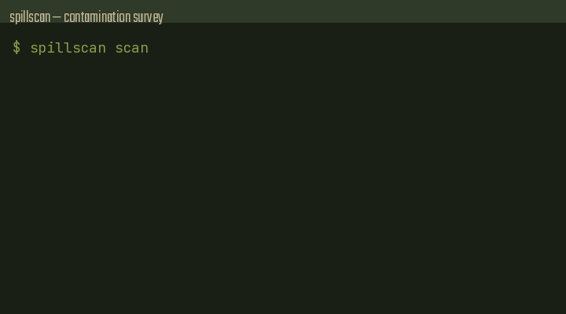

# spillscan

**Tell you, in one command, which secrets already spilled into your local AI coding-agent session transcripts — and scrub them in place with a backup.**

One `env` / `printenv` / `cat .env` inside an agent Bash call writes live credentials into plaintext session JSONL (`~/.claude/projects/**/*.jsonl`, `~/.codex/sessions/**/*.jsonl`, Cursor, …). spillscan finds them and redacts them.



## Install

```bash
go install github.com/Blackman99/spillscan/cmd/spillscan@latest
# or grab a release binary (linux / darwin / windows, amd64 + arm64)
```

## Usage

```bash
spillscan scan
# RULE            PREVIEW         AGENT         FILE:LINE
# aws-akia        AKIA…MPLE       claude-code   ~/.claude/projects/…/session.jsonl:3
echo $?   # 2 if findings, 0 if clean

spillscan redact --write          # writes .bak, replaces with [REDACTED:<rule>]
spillscan paths                   # discovered roots
```

### Guard (Claude Code PreToolUse)

```json
{
  "hooks": {
    "PreToolUse": [
      {
        "matcher": "Bash",
        "hooks": [{ "type": "command", "command": "spillscan guard" }]
      }
    ]
  }
}
```

Install into `.claude/settings.json` (project or user). Denies `env` / `printenv` / `cat .env*` / `/proc/*/environ` even inside `cmd1; env; cmd2` and `bash -c '…'`.

## Why not Stroq / gitleaks?

| | spillscan | Stroq | gitleaks |
|---|---|---|---|
| Unknown secrets (pattern+entropy) | yes | no (local known values) | yes |
| In-place JSONL redact + `.bak` | yes | no (past records unchanged) | no |
| Agent transcript roots | yes | yes | you point it |
| Static binary, ms hook start | yes (Go) | Node ≥22 | yes |

## Docs

https://blackman99.github.io/spillscan/

Pain source: [anthropics/claude-code#80153](https://github.com/anthropics/claude-code/issues/80153)

## License

MIT
